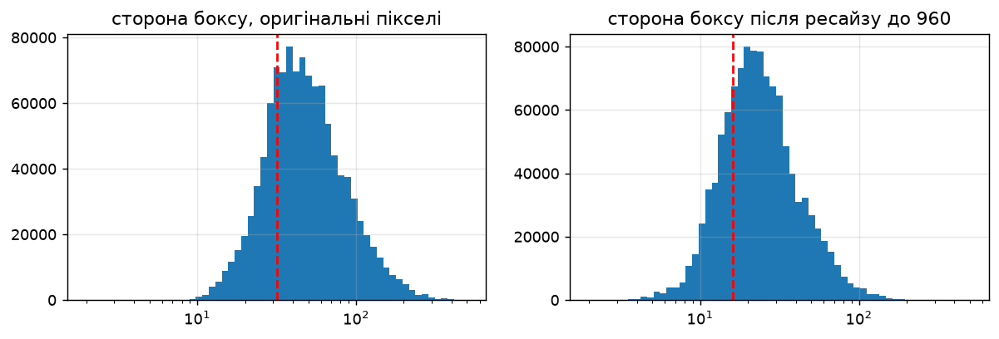
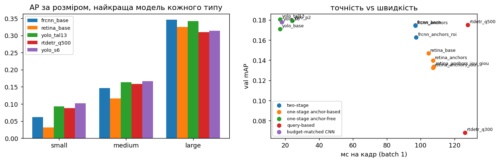
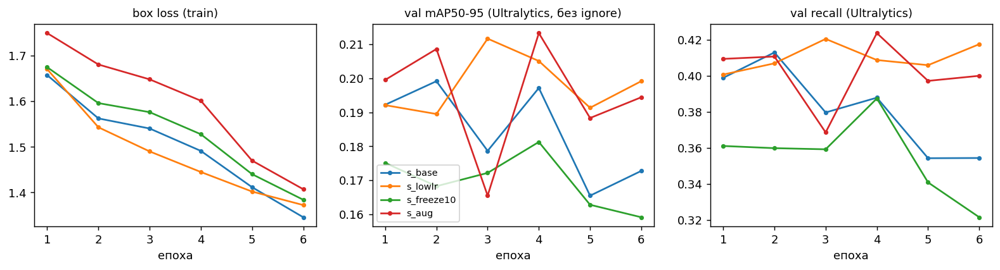
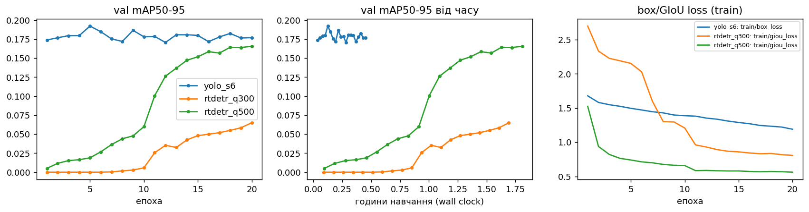

## Вступ

Задача змагання: знайти на кадрах відео 8 класів об'єктів (person, bicycle, car, van, truck, tricycle, bus, motor). Метрика COCO mAP, регіони ignore рахуються як `iscrowd`. Ми порівняли чотири сімейства детекторів (двостадійний Faster R-CNN, одностадійні RetinaNet з anchors і YOLO11 без anchors, RT-DETR на запитах), потім зібрали ансамбль і додали темпоральне перерахування впевненості. Код: ноутбуки `code/01…08`, спільні модулі `common.py`, `tv_models.py`, `yolo_utils.py`, `postprocess.py`, `analysis.py`. Усі числа нижче це val, `common.evaluate`, один запуск на конфігурацію, seed 42.

## Дані та валідація

**EDA.** У train 56 послідовностей, 24 201 кадр, 1,1 млн об'єктів (у середньому 46 на кадр, максимум 180) і ще 0,5 млн ignore-регіонів. У val лише 7 послідовностей. Розподіл класів різний: у train car 46% і person 30%, у val person 44% і car 28%; bus лише 0,9% і 0,2%. Тому AP рідких класів на val шумний, і ми дивимось на mAP по всіх класах.

**Розмір об'єктів.** 25% об'єктів малі (< 32 px) в оригіналі. Після ресайзу довгої сторони до 960 px 24% боксів менші за 16 px, а ще 50% мають 16–32 px. Медіанна сторона: person 18 px, bicycle і motor 19, car 27, bus 52. Це визначило все далі: k-means по розмірах боксів дав 9 anchors від 12×15 до 160×89 px, а стандартні anchors torchvision починаються з 32 px.



**Підготовка.** У train беремо кожен 3-й кадр. Між сусідніми кадрами IoU того самого об'єкта висока: при зсуві 1 кадр IoU > 0.5 у 96% випадків, при 3 кадрах у 76%, при 5 у 59%. Тому крок 3 майже не втрачає інформації, а даних втричі менше. Ignore-регіони у train замальовуємо сірим. Вийшло 8 090 кадрів train, 1 425 val (кожен 2-й кадр) і 3 811 test, довга сторона 960 px. Прогнози повертаємо в оригінальні координати (`common.to_original`), щоб AP_small рахувався так само, як у змаганні. У test є клипи 680×382 і 960×540, яких немає в train, тому розміри об'єктів там інші.

**Валідація.** Оцінка на 7 клипах шумна, тому різниці до ≈ 0.01 mAP ми не вважаємо значущими, а фінальні сабміти вибираємо не лише за public leaderboard.

## Моделі та експерименти

Torchvision-моделі (Faster R-CNN, RetinaNet) мають ResNet50-FPN з вагами COCO і однаковий протокол: SGD, batch 8, 6 епох, AMP, фліп. YOLO11s і RT-DETR-L навчаємо через Ultralytics з вагами COCO. Кожен наступний експеримент змінює один параметр.

| Модель | Конфігурація | mAP | AP50 | AP_small | мс/кадр |
|---|---|---|---|---|---|
| Faster R-CNN | base | 0.175 | 0.365 | 0.062 | 97 |
| | k-means anchors | 0.174 | 0.375 | 0.077 | 97 |
| | + `box_positive_fraction` 0.5 | 0.163 | – | – | 97 |
| RetinaNet | base | 0.147 | 0.287 | 0.032 | 105 |
| | k-means anchors | 0.140 | 0.313 | 0.052 | 105 |
| | + пороги IoU 0.4/0.3 | 0.133 | 0.293 | 0.046 | 105 |
| | + GIoU loss | 0.134 | 0.296 | 0.051 | 105 |
| YOLO11s (25 еп.) | base | 0.171 | 0.338 | 0.090 | 17 |
| | + голова P2 | 0.179 | 0.361 | 0.097 | 24 |
| | TAL top-k 13 | **0.181** | 0.345 | 0.093 | 17 |
| YOLO11s (20 еп., ½ кадрів) | `yolo_s6` | 0.178 | 0.371 | 0.102 | 18 |
| RT-DETR-L (20 еп., ½ кадрів) | 500 запитів | 0.175 | 0.344 | 0.088 | 128 |
| | 300 запитів | 0.068 | 0.147 | 0.028 | 126 |



### Faster R-CNN

RPN з top-1000 пропозицій покриває (IoU ≥ 0.5, клас не важливий) 67.5% малих, 81.1% середніх і 98.7% великих об'єктів, а фінальні детекції з правильним класом лише 49.2%, 64.1% і 92.6%. Отже стеля для малих об'єктів задана першою стадією, і 2000 пропозицій її не піднімають. k-means anchors не змінили mAP, але підняли AP_small з 0.062 до 0.077 та AR_max з 0.393 до 0.408; bicycle виграв (0.114 → 0.137), а van і truck програли. Доля позитивних RoI 0.5 замість 0.25 погіршила mAP до 0.163. Збільшення пропозицій при інференсі 300 → 1000 дає 0.164 → 0.175 mAP, далі приріст 0.001, а час росте з 89 до 128 мс. Найкраща епоха в усіх конфігураціях перша, далі при lr 0.01 mAP не росте. Основні збої: малі об'єкти (recall 0.38 проти 0.84 у великих), bus (recall 0.008) і bicycle (0.125), сильні перекриття (recall 0.137).

### RetinaNet

Стандартні anchors при порозі IoU 0.5 покривають лише 1.5% малих об'єктів, k-means anchors піднімають це до 62.2%, а поріг 0.4 до 83.4%. Це підняло AP_small у 1.6 раза (0.032 → 0.052) і AP50, але mAP впав на 0.007 через AP75 і AP_large (0.325 → 0.275). Ми припускаємо, що причина в найбільшому anchor 224 px, але окремо цього не перевіряли. Нижчі пороги призначення і GIoU не допомогли (в межах шуму). Без стадії пропозицій RetinaNet дає багато фону: 21.3% детекцій при score ≥ 0.3 проти 12.3% у Faster R-CNN. За mAP, AP_small і швидкістю вона програє Faster R-CNN.

### YOLO11 (без anchors)

TaskAlignedAssigner обирає позиції, центр яких лежить усередині об'єкта, тому для малого об'єкта на stride 8 кандидатів мало. Голова P2 (stride 4) піднімає AP50 на 0.023, bicycle (0.135 → 0.183) і bus (0.025 → 0.108), але коштує +42% часу інференсу та +63% GPU-годин. Збільшення top-k призначення з 10 до 13 безкоштовне і дає найкращий mAP (0.181) та AP_large (+0.033), хоча bus падає до 0.005. YOLO у 6 разів швидший за anchor-based моделі (17 мс проти 97 і 105), а AP_small у нього найвищий. Порівняння з torchvision-моделями не чисте: у них інший рецепт (6 епох проти 25 з mosaic). Експеримент з входом 1280 px не виконано, бо не зібрано датасет `prepared_1280` (невдалий експеримент).

### Перенавчання і короткі запуски

Криві val mAP50-95 для 25-епохового YOLO досягають піку на 1–2 епосі (≈ 0.18) і падають до ≈ 0.153, хоча train loss спадає. Тому `best.pt` майже сирі ваги COCO. Гіпотеза: 56 клипів зі скорельованих кадрів швидко запам'ятовуються. У `08` перевірили чотири рецепти по 6 епох: `s_base`, `s_lowlr` (lr0 0.002, косинус), `s_freeze10` (заморожено backbone), `s_aug` (mixup 0.15, scale 0.7). За кривими Ultralytics (без ignore) `s_lowlr` і `s_aug` тримаються вище за `s_base`, `s_freeze10` найгірший, але криві сильно коливаються між епохами.



**TODO (заповнити з таблиці ноутбука 08, `common.evaluate`):** mAP / AP_small для `best.pt` і `last.pt` кожного рецепту, best_epoch, чи підтвердилась гіпотеза про перенавчання, який рецепт взято далі.

### RT-DETR

При однаковому бюджеті (20 епох, кожен 2-й кадр train) RT-DETR-L з 500 запитами дорівнює YOLO11s за mAP (0.175 проти 0.178), але навчання коштує 3.6 проти 0.9 GPU-год, а інференс 128 проти 18 мс. З 300 запитами модель не зійшлася: перші 4 епохи Ultralytics-валідація показувала нуль. Причину ми не встановили: запуск один, схоже на повільний старт, а не на нестачу запитів (медіана 43 об'єкти на кадр). Варіант без denoising-запитів у запуск не входив. У `q500` 15.1% дублікатів при score ≥ 0.3 (YOLO 3.3%), хоча NMS не потрібен. Зате в нього найвищий AR_max, кращі van, bus, bicycle, motor, і на кадрах з ≤ 20 об'єктами mAP удвічі вищий (0.115 проти 0.055). RT-DETR не перевершив YOLO за mAP, швидкістю і вартістю, тому ми використали його як члена ансамблю.



## Фінальне рішення

Інференс іде з оригінальних кадрів: зменшуємо ту саму функцією `common.load_resized`, що й при підготовці train, бокси повертаємо в оригінальні пікселі. Тестуємо зміну моделі, роздільності, TTA, тайлів у стилі SAHI [5], порогу NMS, ансамбль Weighted Boxes Fusion [6] і темпоральне перерахування.

- **Ансамбль WBF** (`yolo_p2`, `yolo_tal13`, `rtdetr_q500`, IoU 0.6). У першому прогоні mAP росла разом із порогом IoU злиття: 0.212 при 0.55 і 0.224 при 0.65.
- **Темпоральний бонус.** Детекції сусідніх кадрів зв'язуємо в треки (угорський алгоритм за IoU, той самий клас), рух камери компенсуємо афінною моделлю ORB + RANSAC. Нова впевненість $s' = (1-w)\,s + w\,\overline{s}_{\text{track}}$, одиночні детекції штрафуємо множником, пропуск у один кадр заповнюємо інтерпольованим боксом. У першому прогоні mAP зростала з $w$ до 0.7 (0.251 → 0.257 → 0.262); штраф для одиночних детекцій і заповнення пропусків mAP не змінили. Сітку параметрів тримали малою, бо 7 клипів легко підігнати.
- **Вибір двох сабмітів:** найкращий за val і найкращий без темпоральної частини, на випадок підгонки під 7 val-клипів.

**TODO (заповнити після фінального прогону `06`, таблиця з `07`):**

| Сабміт | Опис | val mAP | AP_small | Public LB | Private LB |
|---|---|---|---|---|---|
| TODO | TODO | TODO | TODO | TODO | TODO |
| TODO | TODO | TODO | TODO | TODO | TODO |

Також дописати: бейзлайн лідерборду, ефект зміни моделі окремо від інференсу та ансамблю, що дали тайли/TTA/роздільність, і чи збігаються val та public LB.

## Висновки

1. Головна складність даних це малі об'єкти (74% боксів менші за 32 px після ресайзу): стеля RPN 67.5% і покриття anchors пояснюють більшість різниці між моделями.
2. Anchors, підігнані під дані (k-means), піднімають AP_small і AP50, але в нас не mAP через AP75 і великі об'єкти.
3. Anchor-free YOLO11 дав найкращий mAP (0.181) і AP_small при швидкості 17 мс; RT-DETR при малому бюджеті не переміг.
4. Довге навчання на 56 скорельованих клипах перенавчає модель, тому короткі запуски з нижчим lr виглядають розумнішими.
5. Обмеження: по одному запуску на конфігурацію, 7 val-клипів, різниці до 0.01 mAP в межах шуму; `yolo_1280` і `rtdetr_q300_nodn` не запускались.

## Як відтворити

```bash
pip install -r code/requirements.txt   # ultralytics 8.4.202, pycocotools, faster-coco-eval, ensemble-boxes
```

Ноутбуки запускаються на Kaggle по порядку: `01_eda_prepare` (збирає `prepared/`), далі `02`, `03`, `04`, `05`, `08` (виходи попередніх підключаємо як Input), потім `06_final_pipeline` (інференс, ансамбль, темпоральна частина, `submission.csv`) і `07_summary` (таблиці та рисунки). Seed 42; змінна `HW2_DEBUG=1` запускає швидку перевірку. Репозиторій: <https://github.com/ostapmn/ucu_ai_hw_2>.

## Джерела

1. Ren et al. Faster R-CNN, 2015. 2. Lin et al. Focal Loss for Dense Object Detection (RetinaNet), 2017. 3. Jocher, Qiu. Ultralytics YOLO11, <https://github.com/ultralytics/ultralytics>. 4. Zhao et al. DETRs Beat YOLOs on Real-time Object Detection (RT-DETR), 2023. 5. Akyon et al. Slicing Aided Hyper Inference (SAHI), 2022. 6. Solovyev et al. Weighted Boxes Fusion, 2021 (пакет `ensemble-boxes`). 7. Feng et al. TOOD: Task-aligned One-stage Object Detection, 2021. 8. Rezatofighi et al. Generalized IoU, 2019. 9. Bolya et al. TIDE: A General Toolbox for Identifying Object Detection Errors, 2020 (`analysis.error_breakdown` реалізує спрощений варіант). 10. torchvision detection models; pycocotools.
